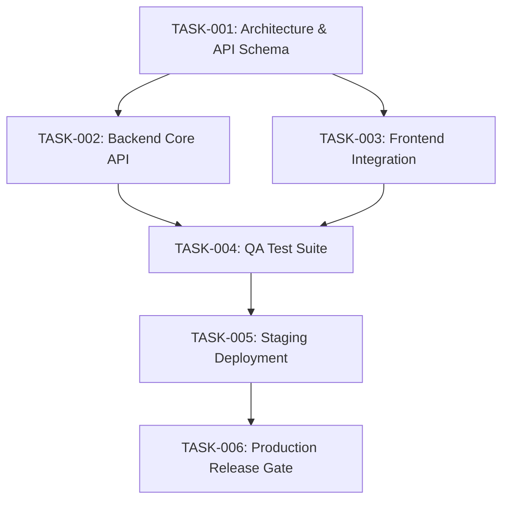

# Master Task Plan: {{PROJECT_NAME}}

## 1. Objective & Scope
- **User Instruction**: {{USER_REQUEST}}
- **Target Repository**: {{REPO_NAME}}
- **Target Branch**: {{BASE_BRANCH}}

---

## 2. Dependency Graph (DAG)

---

## 3. Task Breakdown & Worker Allocations

| Task ID | Role | Title | Allowed Files | Dependencies | Status |
| :--- | :--- | :--- | :--- | :--- | :--- |
| **TASK-001** | Chief Architect | API Contract & Schema Definition | `docs/api/`, `models/` | None | PLANNED |
| **TASK-002** | Senior Engineer 1 | Implement Backend Core Logic | `backend/src/` | TASK-001 | PLANNED |
| **TASK-003** | Senior Engineer 2 | Implement Frontend Interface | `frontend/src/` | TASK-001 | PLANNED |
| **TASK-004** | QA Engineer | Integration & E2E Validation | `tests/` | TASK-002, TASK-003 | PLANNED |
| **TASK-005** | VM Fleet Handler | Deploy & Verify on Staging VM | `deploy/` | TASK-004 | PLANNED |
| **TASK-006** | Security Gate | Release Audit & Production Signoff| `manifests/` | TASK-005 | PLANNED |

---

## 4. Concurrency & Budget Rules
- Maximum concurrent coding workers: **8**
- Default task lease: **600 seconds**
- Maximum defect retries: **3**
